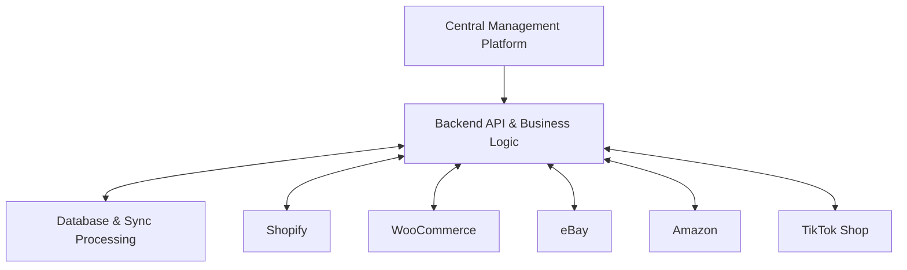
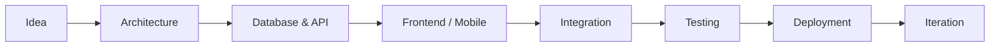

<div align="center">


### 👨‍💻 Building Digital Products From Idea to Production

**Full-Stack Developer • Mobile App Engineer • Backend & API Developer**


<br/>

<a href="https://faisalhussain.netlify.app/">

</a>
<a href="https://github.com/perci7890">

</a>

<br/><br/>


</div>

---

## 🚀 About Me

```typescript
const faisal = {
  name: "Faisal Hussain",
  role: "Full-Stack Software Engineer",
  location: "Karachi, Pakistan",

  specialties: [
    "Full-Stack Web Development",
    "Cross-Platform Mobile Applications",
    "Backend Engineering & REST APIs",
    "E-commerce & Marketplace Integrations",
    "Business Automation & Inventory Systems",
    "AI-Powered Application Features"
  ],

  frontend: ["Angular", "React", "Next.js", "Tailwind CSS"],
  mobile: ["Flutter", "Dart"],
  backend: ["Node.js", "Express", "TypeScript", "NestJS"],
  databases: ["PostgreSQL", "MySQL"],
  architecture: ["REST APIs", "RBAC", "JWT", "WebSockets"],
  interests: ["SaaS", "Automation", "Scalable Systems"],

  philosophy: "Build. Integrate. Ship. Improve."
};
```

I'm a software engineer focused on building **practical, production-oriented digital solutions**.

My experience spans cross-platform mobile applications, full-stack web platforms, backend APIs, business management systems, and third-party integrations.

I enjoy working across the entire development lifecycle — from database design and system architecture to polished interfaces, deployment, and continuous improvement.

**What drives me?** Solving real business problems through reliable, maintainable software.

---

## 🛠️ Technology Arsenal

<div align="center">

### 🎨 Frontend Development


### 📱 Mobile Development


### ⚙️ Backend Engineering


### 🗄️ Databases & Infrastructure


### ☁️ Cloud, Platforms & Design


<br/>

**Additional Technologies & Tools**


</div>

---

## 💼 What I Specialize In

<table>
<tr>
<td width="50%" valign="top">

### 🌐 Full-Stack Applications

- Responsive web applications
- Angular, React & Next.js
- Admin panels and dashboards
- Business management platforms
- SaaS application development
- Authentication & role-based access
- Custom workflows and automation

</td>
<td width="50%" valign="top">

### 📱 Mobile Engineering

- Flutter for Android & iOS
- REST API integrations
- Authentication and social sign-in
- Firebase integrations
- In-app purchases & subscriptions
- Local storage and offline workflows
- Media processing and playback

</td>
</tr>
<tr>
<td width="50%" valign="top">

### ⚙️ Backend & Architecture

- Node.js, Express & TypeScript
- RESTful API development
- PostgreSQL & TypeORM
- JWT authentication & RBAC
- Real-time Socket.IO features
- Background jobs and queues
- Third-party service integrations

</td>
<td width="50%" valign="top">

### 🛒 Commerce Engineering

- Multi-store inventory management
- Shopify & WooCommerce
- Marketplace API integrations
- Product and order synchronization
- Product import and publishing
- Webhook-based workflows
- Background synchronization jobs

</td>
</tr>
</table>

---

## 🏆 Featured Projects

### 🛍️ Multi-Store Inventory & Marketplace Management

**Full-Stack Commerce Platform | Inventory Automation | Marketplace Integration**

A centralized inventory and commerce management platform designed to simplify operations across multiple online stores and marketplaces.

**Key Capabilities**

- Centralized product and inventory management
- Multiple store connections
- Product import and publishing workflows
- Cross-platform product synchronization
- Order and inventory management
- Platform-specific product handling
- Synchronization status and history
- Error handling and retry mechanisms
- Background processing and queue-based operations
- Administrative dashboards and business workflows

**Marketplace Ecosystem**


**Technology:** `Angular` `Node.js` `Express` `TypeScript` `TypeORM` `PostgreSQL`

**🎬 Project Demonstration**

https://github.com/user-attachments/assets/REPLACE_WITH_VIDEO_ID

> A demonstration of the platform's interface and core inventory workflows. Replace the video placeholder with an uploaded GitHub video.

---

### 📚 YouinX — Digital Reading Ecosystem

**Flutter Mobile App | Content Platform | Backend Integration**

Contributed to a digital reading ecosystem spanning mobile applications, content management, and administrative interfaces.

**Areas of Development**

- Flutter mobile application interfaces
- Reader-focused user experiences
- API integration and backend connectivity
- Content and account management workflows
- Angular-based BookStudio interfaces
- React-based administration interfaces
- Authentication and data-driven features

**Technology:** `Flutter` `Dart` `Angular` `React` `REST APIs`

---

### 🚚 ADX Logistics — Shipping & Waybill Management

**Logistics Automation | Angular | WordPress | Custom APIs**

Developed and contributed to logistics workflows connecting a web application with custom WordPress backend services.

**Key Features**

- Shipment and waybill generation
- Shipper and consignee management
- Barcode-based shipping labels
- Invoice and document printing
- Shipment status tracking
- Administrative management workflows
- Custom WordPress database tables
- Custom REST API endpoints
- JWT-based authentication

**Technology:** `Angular` `WordPress` `PHP` `MySQL` `REST APIs`

---

### 📋 TMMS — Workflow & Management System

**Enterprise Web Application | Backend Services | Real-Time Features**

Worked on a management platform involving structured business workflows, API services, and user-specific notifications.

**Key Features**

- Role-based access workflows
- Request creation and cancellation
- Workflow status management
- Real-time notifications with Socket.IO
- Relational database integration
- Backend API development
- Administrative interfaces

**Technology:** `Angular` `Node.js` `TypeORM` `PostgreSQL` `Socket.IO`

---

### ☀️ Solar Commerce & Services Platform

**E-commerce | Solar Calculators | Installation & Maintenance**

A Pakistan-focused solar commerce and service platform combining equipment discovery, system planning, and service workflows.

**Areas of Development**

- Solar product catalog and storefront
- System sizing and cost estimation
- Installation and service booking flows
- Maintenance and inspection workflows
- Customer quotation experiences
- Responsive business interfaces

**Focus:** `Full-Stack Development` `E-commerce` `Business Automation`

---

### ☀️ TanGlow — Service & Appointment Platform

**Mobile Application | Booking Workflows | Backend APIs**

A service-oriented application ecosystem built around tanning services and appointment management.

**Technology:** `Flutter` `Node.js` `Express` `PostgreSQL` `REST APIs`

---

## 🔗 E-commerce & API Integrations

<div align="center">

**Building connections between platforms, services, and business operations.**

</div>



My integration work focuses on connecting systems through APIs, synchronizing business data, and making complex workflows easier to manage.

**Core areas:** Product data • Inventory • Orders • Webhooks • Authentication • Synchronization • Error handling

---

## 🤖 AI & Automation

I explore and integrate AI-powered functionality into applications to improve content workflows, user experiences, and business operations.

**Technologies & Areas**


- AI-assisted content generation
- OpenAI and Gemini API integration
- AI features in mobile applications
- Backend-driven AI requests
- Content and media workflows
- Workflow automation concepts

---

## 🧩 How I Engineer Software



I believe good software should be:

**Maintainable** — Easy to understand and extend.

**Secure** — Built with appropriate authentication and access controls.

**Scalable** — Designed with future growth in mind.

**Practical** — Focused on real user and business needs.

**Reliable** — Supported by testing, error handling, and monitoring.

---

## 📊 GitHub Analytics

<div align="center">


<br/>


</div>

> GitHub statistics reflect public repository activity and may not represent work completed in private or client-owned repositories.

---

## 📈 Contribution Activity

<div align="center">


</div>

---

## 🐍 Contribution Snake

<div align="center">


</div>

---

## 🎯 Currently Focused On

- Building and improving full-stack business applications
- Multi-platform commerce and inventory systems
- Scalable backend architecture and API integrations
- Flutter mobile application development
- AI integrations and workflow automation
- Creating practical software products for real businesses

---

## 🤝 Let's Connect

I'm interested in opportunities involving **full-stack development, Flutter, backend engineering, e-commerce systems, and software product development**.

Whether it's a mobile application, business platform, backend integration, or a complete software product, I enjoy collaborating on meaningful technical challenges.

<div align="center">

<a href="https://faisalhussain.netlify.app/">

</a>

<a href="https://github.com/perci7890">

</a>

<br/><br/>

**📍 Karachi, Pakistan | 🌍 Remote & On-site Opportunities**

</div>

---

<div align="center">


### 💻 Build. Integrate. Ship. Improve.

*Turning complex ideas into useful software.*

**Thanks for visiting! 👋**

</div>
