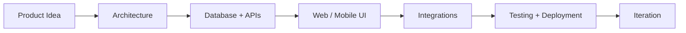

### I turn complex ideas into production-ready digital products.

 

 

---

## `> whoami`

I'm **Faisal Hussain**, a **Full-Stack Software Engineer** working across **web, mobile, backend, and integrations**. I build applications end to end: architecting databases, developing secure APIs, creating responsive interfaces, connecting third-party platforms, and getting software ready for real users.

My work includes **multi-store commerce systems, Flutter apps, enterprise workflows, logistics automation, custom WordPress integrations, and AI-assisted experiences**.

- 🧩 **What I build:** Full-stack applications, mobile products, backend services, and business platforms
- ⚙️ **What I enjoy:** Solving tricky integration problems and simplifying complex workflows
- 🛒 **Special interest:** E-commerce, inventory synchronization, and marketplace APIs
- 🚀 **Engineering mindset:** Practical architecture, maintainable code, and iterative delivery
- 🤝 **Opportunities:** Remote and on-site software engineering roles and collaborations

---

## ⚡ Engineering Toolkit

**FRONTEND & WEB**

**MOBILE**

**BACKEND & DATA**

**TOOLS & DELIVERY**

 

---

## 🏗️ What I Bring to a Project

<table>
<tr>
<td width="50%" valign="top">

### 🌐 Full-Stack Development

Responsive interfaces, admin dashboards, SaaS-style platforms, authentication, business workflows, and custom web applications.

**Angular · React · Next.js · TypeScript**

</td>
<td width="50%" valign="top">

### 📱 Cross-Platform Mobile

Flutter applications for Android and iOS, API integration, social login, media experiences, local storage, and subscription flows.

**Flutter · Dart · Firebase**

</td>
</tr>
<tr>
<td width="50%" valign="top">

### ⚙️ Backend Engineering

REST APIs, relational data modeling, role-based access, JWT authentication, real-time notifications, and asynchronous workflows.

**Node.js · Express · TypeORM · PostgreSQL**

</td>
<td width="50%" valign="top">

### 🛒 Commerce & Integrations

Product imports, multi-store operations, marketplace connectors, inventory workflows, synchronization, webhooks, and error recovery.

**Shopify · WooCommerce · eBay · APIs**

</td>
</tr>
</table>

---

## 🌟 Selected Work

### 01 / Multi-Store Inventory & Marketplace Management

**Featured Project** · Full-stack commerce platform · Business automation

A centralized platform designed to help merchants manage products, inventory, stores, and marketplace operations without switching between disconnected systems.

<table>
<tr>
<td width="50%" valign="top">

**Platform capabilities**

- Centralized product and inventory management
- Multi-store connections and administration
- Product import and publishing workflows
- Cross-platform synchronization
- Order and inventory workflows
- Sync tracking, errors, and retry handling
- Background processing and integration services

</td>
<td width="50%" valign="top">

**Engineering focus**

- Angular-based management experience
- Node.js and Express APIs
- TypeScript business logic
- PostgreSQL and TypeORM
- Marketplace-specific data mapping
- Reliable external API interactions
- Queue-oriented synchronization patterns

</td>
</tr>
</table>

**Commerce ecosystem:**

#### 🎬 Watch the Product Walkthrough

 

*See the application and its management workflows in action.*

> The demo opens on Kapwing. To play directly inside GitHub, upload an MP4 as a GitHub attachment and replace this section with the resulting attachment URL.

---

### 02 / YouinX — Digital Reading Ecosystem

**Mobile experiences · Reader workflows · Content platforms**

Contributed to a digital reading ecosystem with a Flutter mobile experience, API-connected content features, and complementary web-based tools for content and administration.

`Flutter` `Dart` `Angular` `React` `REST APIs`

**Highlights:** Reader-oriented mobile UI, account and content workflows, BookStudio interfaces, and administration features.

---

### 03 / Younbooks & Learning Experiences

**Flutter · Content delivery · Mobile UI**

Worked on Flutter-driven reading and learning experiences, including responsive layouts, profile-based flows, media handling, and API-connected functionality.

`Flutter` `Dart` `Responsive UI` `API Integration`

---

### 04 / ADX Logistics — Shipping & Waybill System

**Logistics automation · Custom WordPress APIs · Angular**

Developed and contributed to shipping workflows connecting a web interface with custom WordPress backend services.

**Highlights:** Waybill generation, shipper/consignee forms, barcode labels, invoice printing, shipment status management, custom database tables, and authenticated API endpoints.

`Angular` `PHP` `WordPress` `MySQL` `REST APIs` `JWT`

---

### 05 / TMMS — Enterprise Workflow Platform

**Business workflows · Real-time notifications · Relational data**

Contributed to an enterprise management system featuring request lifecycle operations, user-specific notifications, backend services, and data-driven administration.

**Highlights:** Request management, access-controlled workflows, Socket.IO notifications, relational data models, and API development.

`Angular` `Node.js` `TypeORM` `PostgreSQL` `Socket.IO`

---

### 06 / TanGlow — Service & Appointment Ecosystem

**Mobile application · Booking workflows · Backend services**

A service-oriented application ecosystem centered on appointment management, user experiences, and API-backed operations.

`Flutter` `Node.js` `Express` `PostgreSQL` `REST APIs`

---

### 07 / Solar Commerce & Service Platform

**E-commerce · Solar planning · Service booking**

A Pakistan-focused solar commerce and service platform project combining equipment discovery, solar planning experiences, quotations, and installation or maintenance workflows.

`Full-Stack Web` `E-commerce` `Responsive UI` `Business Workflows`

---

### 08 / Custom WordPress & Business Websites

**Business websites · Plugin development · API integrations**

Experience building and customizing WordPress-based business systems, integrating them with Angular applications, and developing tailored workflows beyond conventional content management.

**Highlights:** Custom plugins, database-backed forms, REST endpoints, business dashboards, and responsive website experiences.

`WordPress` `PHP` `MySQL` `JavaScript` `REST APIs`

**Explore more work:** [View my complete portfolio](https://faisalhussain.netlify.app/)

---

## 🔄 From UI to Infrastructure

I care about **clear architecture, secure data handling, maintainable code, resilient integrations, and interfaces that people actually enjoy using**.

---

## 🤖 AI-Powered Features & Automation

My application work also includes integrating **OpenAI and Google Gemini APIs** into backend-driven content generation workflows and mobile experiences.

- AI-assisted text and content generation
- Backend-managed AI API requests
- Media and content creation workflows
- Application features that combine AI output with user controls
- Exploration of workflow automation and service integrations

---

## 📊 GitHub Activity

 

> GitHub statistics reflect visible repository activity, not the full scope of private or client work. Third-party statistics widgets may occasionally be unavailable.

---

## 🎯 What I'm Exploring

`Scalable backend architecture` · `Multi-platform commerce` · `Flutter products` · `AI integrations` · `Workflow automation` · `Practical SaaS`

---

### Have a project or engineering challenge in mind?

I enjoy collaborating on products that solve meaningful problems — from a mobile app or internal dashboard to a full-stack platform with complex integrations.

 

**Build thoughtfully. Integrate reliably. Ship confidently.**

