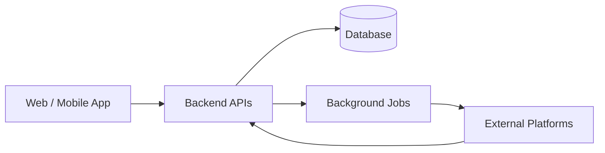

  

 

  

---

## 👨‍💻 About Me

I’m **Faisal Hussain**, a full-stack software engineer based in Karachi, Pakistan. I build web and mobile applications, backend systems, custom business tools, and integrations that connect platforms and simplify real operations.

My work spans **Flutter apps, Angular and React interfaces, Node.js APIs, PostgreSQL databases, WordPress development, and e-commerce integrations**. I enjoy working across the product lifecycle—from designing the data model to shipping the user experience.

> **My focus:** Practical software. Thoughtful architecture. Reliable integrations. Continuous improvement.

## ⚡ What I Build

| 🖥️ Web & Business Systems | 📱 Mobile Applications |
|:--|:--|
| Angular, React, Next.js, dashboards, admin panels | Flutter for Android & iOS, responsive layouts, API-connected features |
| ⚙️ Backend & Data | 🛒 Commerce & Integrations |
| Node.js, Express, TypeScript, REST APIs, PostgreSQL, TypeORM | Shopify, WooCommerce, eBay, Amazon & TikTok Shop workflows |
| 🔄 Real-Time & Automation | 🤖 AI Features |
| Socket.IO, webhooks, background jobs, sync workflows | OpenAI & Gemini API integrations, AI-assisted content experiences |

## 🧰 Technical Toolkit

| Area | Technologies & Experience |
|:--|:--|
| **Frontend** | Angular · React · Next.js · TypeScript · JavaScript · Tailwind CSS · HTML/CSS |
| **Mobile** | Flutter · Dart · Android · iOS · Firebase · local persistence · media processing |
| **Backend** | Node.js · Express · REST APIs · JWT · RBAC · Socket.IO · NestJS |
| **Data & Jobs** | PostgreSQL · MySQL · TypeORM · Redis · BullMQ · RabbitMQ |
| **Commerce** | Shopify · Liquid · WooCommerce · eBay · Amazon · TikTok Shop · WordPress plugins |
| **AI & Tools** | OpenAI API · Gemini API · Git · GitHub · Docker · Postman · Figma |
| **Deployment** | Railway · Netlify · cloud-hosted application workflows |

---

## 🚀 Featured Work

### 01 / Multi-Store Inventory & Marketplace Management

**Centralized commerce operations · Full-stack platform · API integrations**

A business platform for managing stores, products, inventory and marketplace workflows from one place. My work includes product import and publishing, store integrations, inventory management, synchronization handling and administrative workflows.

`Angular` `Node.js` `Express` `TypeScript` `TypeORM` `PostgreSQL` `Marketplace APIs`

### 02 / YouinX — Digital Reading Ecosystem

Contributed to a digital content ecosystem spanning a **Flutter reading application**, an **Angular BookStudio** interface, and **React-based administration**. Worked on user experiences, application flows and backend-connected features.

`Flutter` `Dart` `Angular` `React` `REST APIs`

### 03 / Younbooks & Mobile Content Experiences

Worked on Flutter-based reading and content experiences, including responsive UI, account workflows, media-related features and API-connected screens.

`Flutter` `Dart` `Mobile UI` `REST APIs`

### 04 / ADX Logistics — Shipping & Waybill System

Built and contributed to shipping workflows with **Angular**, **custom WordPress plugins** and **REST endpoints**, including waybill generation, shipper/consignee forms, barcode labels, invoice previews, shipment status records and authentication.

`Angular` `PHP` `WordPress` `MySQL` `JWT` `REST APIs`

### 05 / TMMS — Management & Workflow Platform

Contributed to a business management application with request workflows, relational data models, status handling, user notifications and **Socket.IO real-time events**.

`Angular` `Node.js` `Express` `TypeORM` `PostgreSQL` `Socket.IO`

### 06 / TanGlow — Service & Appointment Ecosystem

A mobile and backend application ecosystem supporting service-oriented experiences and appointment workflows.

`Flutter` `Node.js` `Express` `PostgreSQL` `REST APIs`

### 07 / Interactive Learning Application

Flutter-based learning experiences featuring profile and avatar selection, level progression, interactive activities, parental verification, audio experiences and progress reporting.

`Flutter` `Dart` `Responsive UI` `Local Storage`

### 08 / Custom WordPress & Business Websites

Custom WordPress plugins, data-entry tools, REST integrations, responsive business websites and storefront customization. My broader web work includes business websites, landing pages and design-to-development implementation.

`WordPress` `PHP` `MySQL` `JavaScript` `WooCommerce`

 

<strong>BEYOND THE CODE</strong>

<h2>Explore What I've Built.</h2>

  Real-world applications, live products, and engineering projects — all in one place.

  

---

## 🔗 How I Approach Integrations

I work on the practical challenges behind connected software: **authentication, data mapping, pagination, API limits, webhook handling, retry behavior, synchronization status and operational visibility**.

## 🧠 Engineering Principles

- **Build for maintainability:** Clear modules, understandable data models and reusable components.
- **Design for real users:** Responsive interfaces, practical workflows and meaningful feedback.
- **Handle failure thoughtfully:** Validation, useful errors, safe retries and operational visibility.
- **Keep systems secure:** Appropriate authentication, authorization and careful API design.
- **Ship and improve:** Deliver usable features, learn from real behavior and iterate.

---

## 📊 GitHub Activity

 

## 🤝 Let's Build Something Great

Have an interesting project, collaboration opportunity, or engineering challenge?

I'm always interested in building meaningful digital products and solving real-world problems.

  
💻 Designed with purpose. Engineered for impact.
  

